# Barangay San Isidro Database Schema

## Status and scope

This is the proposed first MySQL schema for the UI/backend work approved by the project owner. The complete DDL and baseline migration are in [`database/migrations/001_initial_schema.sql`](./database/migrations/001_initial_schema.sql).

**The owner reports that this migration has been applied to Aiven; the application connection and schema were not independently verified in this workspace.** The production login and resident account-request endpoints use this schema. Other signed-in PHP pages still use legacy table names and columns from `bgry_profiling`; this migration does not adapt those pages or migrate legacy data.

## Requirements and safeguards

- MySQL **8.0.16 or later** is required for enforced `CHECK` constraints, JSON columns, and the generated-column indexes used to constrain active household membership.
- Tables use InnoDB, `utf8mb4`, and UTC `DATETIME(3)` values. The SQL sets the migration connection timezone to UTC; the PHP connection must also use UTC.
- Passwords are stored only as `password_hash` values. Verification/reset tables store SHA-256 token digests, not usable raw tokens.
- Uploaded files are represented by metadata and an opaque `storage_key`. File bytes must be stored outside the public web root, with authorization checks on every download. The schema does not store file contents.
- Foreign keys generally restrict deletion of records with workflow history. Use account deactivation and archival, and define a retention/deletion policy before handling real personal data.
- The seed rows create role names and permission definitions only. They do **not** create an admin login or grant an account the administrator role.
- Role, account, and workflow status columns are not a replacement for server-side authorization. PHP must authorize every read/write and enforce allowed state transitions in transactions.
- `metadata` in `audit_logs` must contain only minimized operational details; do not copy credentials, tokens, full documents, or unnecessary resident details into audit records.

## Entity relationship diagram

```mermaid
erDiagram
    USERS ||--o{ USER_ROLES : receives
    ROLES ||--o{ USER_ROLES : assigned
    ROLES ||--o{ ROLE_PERMISSIONS : grants
    PERMISSIONS ||--o{ ROLE_PERMISSIONS : included
    USERS ||--o{ USER_PERMISSION_OVERRIDES : has
    PERMISSIONS ||--o{ USER_PERMISSION_OVERRIDES : overridden
    USERS ||--o| STAFF_PROFILES : has
    USERS ||--o| RESIDENTS : linked_to
    USERS ||--o| OFFICIALS : linked_to
    USERS ||--o{ EMAIL_VERIFICATION_TOKENS : receives
    USERS ||--o{ PASSWORD_RESET_TOKENS : receives
    RESIDENTS ||--o{ RESIDENT_VERIFICATION_REVIEWS : reviewed
    RESIDENT_VERIFICATION_REVIEWS ||--o{ RESIDENT_VERIFICATION_ATTACHMENTS : includes
    HOUSEHOLDS ||--o{ HOUSEHOLD_MEMBERS : contains
    RESIDENTS ||--o{ HOUSEHOLD_MEMBERS : belongs
    DOCUMENT_TYPES ||--o{ DOCUMENT_REQUIREMENTS : requires
    RESIDENTS ||--o{ DOCUMENT_REQUESTS : submits
    DOCUMENT_TYPES ||--o{ DOCUMENT_REQUESTS : requested
    DOCUMENT_REQUESTS ||--o{ DOCUMENT_REQUEST_ASSIGNMENTS : assigned
    USERS ||--o{ DOCUMENT_REQUEST_ASSIGNMENTS : staff
    DOCUMENT_REQUESTS ||--o{ REQUEST_ATTACHMENTS : includes
    DOCUMENT_REQUIREMENTS o|--o{ REQUEST_ATTACHMENTS : may_satisfy
    DOCUMENT_REQUESTS ||--o{ REQUEST_STATUS_HISTORY : tracks
    RESIDENTS ||--o{ CONCERNS : submits
    CONCERNS ||--o{ CONCERN_ASSIGNMENTS : assigned
    USERS ||--o{ CONCERN_ASSIGNMENTS : staff
    CONCERNS ||--o{ CONCERN_ATTACHMENTS : includes
    CONCERNS ||--o{ CONCERN_STATUS_HISTORY : tracks
    USERS ||--o{ ANNOUNCEMENTS : authors
    USERS ||--o{ MESSAGE_THREADS : creates
    MESSAGE_THREADS ||--o{ THREAD_PARTICIPANTS : includes
    USERS ||--o{ THREAD_PARTICIPANTS : participates
    MESSAGE_THREADS ||--o{ MESSAGES : contains
    USERS ||--o{ MESSAGES : sends
    USERS ||--o{ NOTIFICATIONS : receives
    USERS ||--o{ AUDIT_LOGS : acts
    USERS ||--o{ SYSTEM_SETTINGS : updates
```

The diagram omits the migration bookkeeping table and individual actor/approver foreign keys for readability. All declared keys and indexes are in the SQL migration.

## Tables and purpose

| Table | Purpose and key relationships |
|---|---|
| `schema_migrations` | Applied migration version and timestamp. |
| `users` | Login identity, required unique email, password hash, email verification, and account lifecycle. |
| `roles` | Resident, staff, and administrator role definitions. |
| `permissions` | Permission codes enforced by PHP. |
| `role_permissions` | Many-to-many role-to-permission grants. |
| `user_roles` | Role assignments per user, with the assigning account and timestamp. |
| `user_permission_overrides` | Explicit allow/deny overrides for an individual user. |
| `staff_profiles` | Staff identifier, work title/department, and separate admin approval state. |
| `email_verification_tokens` | One-time, expiring email verification token digests. |
| `password_reset_tokens` | One-time, expiring password reset token digests. |
| `residents` | Resident identity/profile with optional link to a portal account and verification state. |
| `officials` | Barangay official roster, terms, and optional portal account link. |
| `households` | Household code and address. |
| `household_members` | Resident-to-household membership and head relationship, with membership dates. Generated unique keys allow at most one active household per resident and one active head per household. |
| `resident_verification_reviews` | Review submissions/decisions with reviewer, status, explanation, and time. |
| `resident_verification_attachments` | Private-storage metadata for verification documents. |
| `document_types` | Service/document catalog, availability, and fee. |
| `document_requirements` | Ordered requirements for a document type. |
| `document_requests` | Resident document request and current workflow state. |
| `document_request_assignments` | Assignment history for requests and staff. |
| `request_attachments` | Private-storage metadata for files submitted with a request, optionally linked to a catalog requirement. |
| `request_status_history` | Append-oriented request state transition history. |
| `concerns` | Resident-submitted concern, priority, and current state. |
| `concern_assignments` | Concern assignment history and staff. |
| `concern_attachments` | Private-storage metadata for concern evidence. |
| `concern_status_history` | Append-oriented concern state transition history. |
| `announcements` | Public or role-targeted draft, scheduled, published, or archived notice. |
| `message_threads` | Message conversation subject and creator. |
| `thread_participants` | Membership and read position for each conversation participant. |
| `messages` | Message body, sender, and timestamp. |
| `notifications` | Per-user notification and read timestamp. Related entity fields are informational references, not foreign keys. |
| `audit_logs` | Timestamped operational audit events with optional account, entity, IP, and minimized JSON metadata. |
| `system_settings` | JSON settings values with the last updater and timestamp. |

### Column-level specification

The migration is the authoritative column-level schema: each `CREATE TABLE` declaration lists each column's MySQL type, nullability, default, primary and foreign keys, unique constraints, indexes, and checks. All tables use InnoDB. Fields without `NULL` are required; fields marked `NULL` are optional. `*_id` keys are unsigned, auto-incrementing `BIGINT` except the small role/permission lookup keys. Workflow state values are explicit `ENUM`s. Timestamps use UTC by convention.

## Key relationships and invariants

- A user may link to at most one resident profile, staff profile, or official roster record; those records can exist without a login account where the workflow allows it.
- A household can have dated membership history. At most one current household membership is allowed per resident, and at most one active household head is allowed per household. The application must ensure each active household has a head when required.
- A staff account must be approved before it is activated or assigned staff permissions. The database does not make a user role assignment prove that the linked account is a staff member; PHP must validate it.
- Email is required and unique per account. PHP must create/consume expiring verification tokens and must not activate accounts whose email is unverified.
- Request/concern assignment tables preserve reassignment history. Their active queues are selected using `unassigned_at IS NULL`.
- Request and concern records contain the current state; their history tables record each transition in the same transaction. PHP must validate transition rules and write both records atomically.
- A message sender must be a participant in the thread. Enforce this in the service layer/transaction.
- The default resident role is intentionally self-scoped. Staff data access must additionally be checked against explicit assignment and permission rules.
- Audit and workflow history should be append-only through the application. Do not expose update/delete operations for ordinary users.

## Legacy application compatibility

The existing PHP code currently uses a configured database named `bgry_profiling`; the legacy dashboard expects `users`, `residents`, `family`, `officials`, and `certificates` tables. This migration instead creates a separate database with normalized names and linked workflows. It does not rename, copy, or alter any legacy table, and it cannot be applied as a drop-in replacement for the existing PHP pages.

| Existing concept | Proposed schema mapping |
|---|---|
| Legacy `users.id`, `username`, `password` | `users.user_id`, `username`, required `email`, `password_hash`; PHP login query and any records without email need deliberate migration handling. |
| Legacy `residents.Resident_ID`, name fields | `residents.resident_id`, `resident_code`, and normalized name columns. |
| Legacy `family.Family_ID`, `Family_Name`, `Address`, `Head_of_Family` | `households` and `household_members`. The household head is represented as an active member with `is_head = TRUE`. |
| Legacy `officials` count/roster | `officials`; actual column mapping requires checking the installed legacy table definition. |
| Legacy `certificates` count/list | `document_requests` and `document_types`; a migration must determine which legacy certificate rows are completed records and map their statuses/owners before copying them. |

No legacy data migration is included because the live database schema, data quality, and backup state have not been verified. In particular, do not point existing PHP code at this new database until the auth query, family handler, and all page queries have been updated and tested.

## Applying and reviewing the migration

1. Review the schema and confirm the business rules and status names.
2. Back up any existing database before any later data migration.
3. Use a MySQL 8.0.16+ server and a deployment account with permission to create the new database.
4. Apply `database/migrations/001_initial_schema.sql` once to an empty target. The script creates `barangay_san_isidro`, applies the baseline tables and role/permission definitions, then records version `001_initial_schema`.
5. Verify the table/constraint definitions and lookup rows before beginning PHP integration.
6. For production, create a separate least-privilege application DB account; do not use the development `root` account or commit credentials.

The SQL is a baseline migration, not an idempotent installer. Do not rerun it on a populated database. MySQL DDL may commit implicitly; if a run fails partway, inspect the target database and restore/recreate it only after confirming that it is the empty development target.
